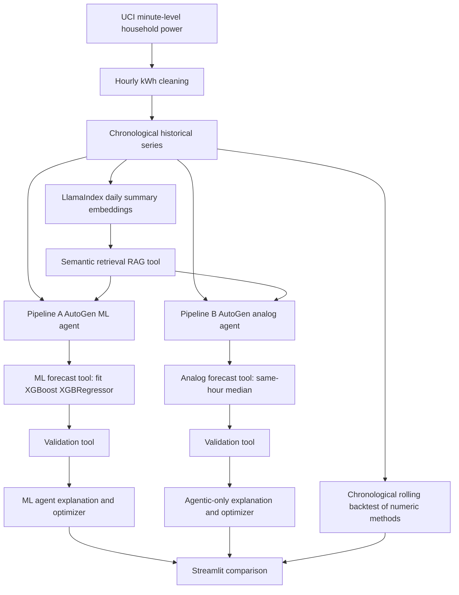

# Dual Forecasting Architecture

**Important:** The agentic-only approach has no trained ML forecaster, but uses a deterministic Python analog forecasting tool selected and invoked by AutoGen. LLMs are not asked to invent 24 numerical predictions. RAG retrieves historical summaries; it is not itself a forecasting model. Backtest metrics evaluate the numerical tools, not the quality of agent decisions.
